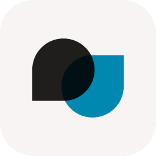
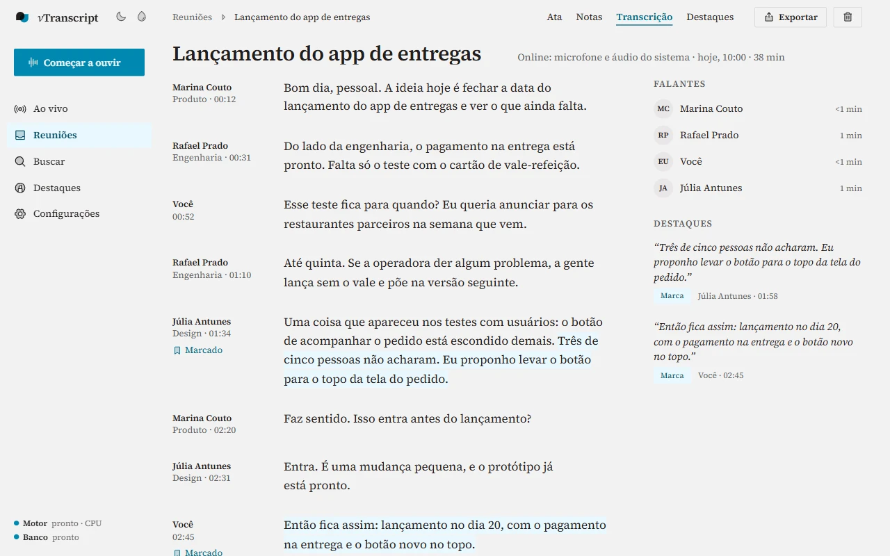
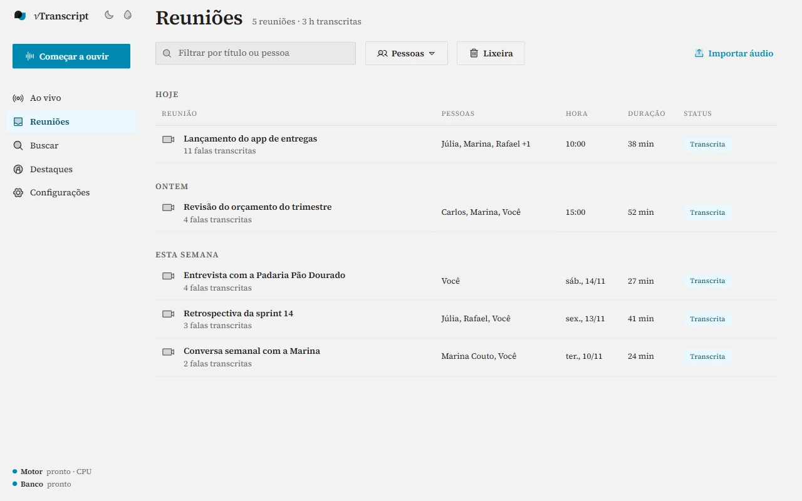
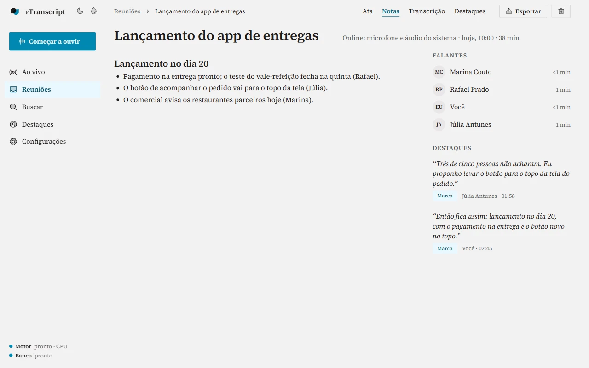
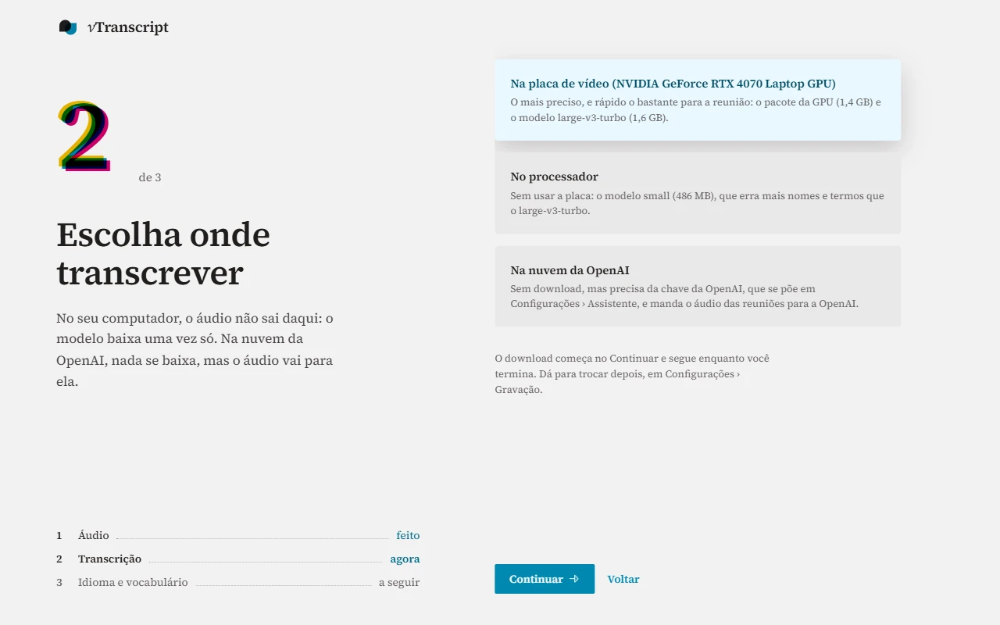

# vTranscript

**As suas reuniões, transcritas no seu computador.**

O vTranscript ouve o microfone e o áudio do sistema, transcreve enquanto a reunião acontece e reconhece quem fala. 
Cada reunião fica guardada com as suas notas e a ata, sem robô na chamada e sem conta.

 

 

<picture>
  <source media="(prefers-color-scheme: dark)" srcset="imagens/reuniao-escuro.webp">
  
</picture>

  <a href="#baixar-e-instalar"><b>Baixar</b></a> &nbsp;·&nbsp;
  <a href="#primeiros-passos">Primeiros passos</a> &nbsp;·&nbsp;
  <a href="#a-chave-da-openai">A chave da OpenAI</a> &nbsp;·&nbsp;
  <a href="#o-que-ele-faz">O que ele faz</a> &nbsp;·&nbsp;
  <a href="#privacidade">Privacidade</a> &nbsp;·&nbsp;
  <a href="#perguntas-frequentes">Perguntas</a>

<b>In English</b>

 

vTranscript is a free Windows desktop app for your meetings.
- It listens to your microphone and to the system audio: Meet, Teams, Zoom or any other app, with no bot joining the
  call.
- It transcribes as the meeting happens and recognizes who is speaking by their voice.
- It notices when a meeting starts (Teams, Zoom, Meet in the browser and others) and offers to record it, with a
  ready-made consent message to paste in the meeting chat.
- It keeps every meeting with your notes. With your own OpenAI key, it also writes the minutes.

Transcription runs on your computer, on an NVIDIA graphics card or on the CPU, or through OpenAI's API. There is no
account and no server. The interface is in Brazilian Portuguese. [Download the latest installer](../../releases/latest).

## Por quê

Transcrever uma reunião costuma pedir um robô que entra na chamada, uma conta num serviço e o áudio de todo mundo na
nuvem de alguém. O vTranscript ouve pelo próprio computador, como você ouve: o seu microfone e o som que sai dos
alto-falantes. A transcrição fica no seu disco, ao lado das notas que você escreve durante a reunião, e dá para achar e
exportar depois.

## Baixar e instalar

1. **Baixe** o `vTranscript_x.y.z_x64-setup.exe` na [página da versão mais recente](../../releases/latest).
2. **Abra o instalador.** Ele instala só para você, sem pedir administrador, em `%LOCALAPPDATA%\vTranscript`.
3. **Abra o vTranscript** pelo menu Iniciar. A primeira abertura pergunta onde transcrever e baixa o que a escolha
   precisa.

> [!IMPORTANT]
> O instalador ainda não tem assinatura de código, por isso o Windows pode mostrar **"O Windows protegeu o
> computador"**. Clique em **Mais informações** e depois em **Executar assim mesmo**.

- **O sistema:** Windows 10 ou 11, de 64 bits.
  - O WebView2 já vem no Windows 11; no 10, o instalador o baixa se faltar.
  - Para transcrever na placa de vídeo, é preciso uma NVIDIA com o driver atualizado.
- **O que a primeira abertura baixa**, conforme a escolha:

  | Onde transcrever | O que baixa | Tamanho |
  | --- | --- | --- |
  | Na placa de vídeo (NVIDIA) | o pacote da GPU (o cuBLAS e o cuDNN da NVIDIA) e o modelo large-v3-turbo | 1,4 GB e 1,6 GB |
  | No processador | o modelo small | 486 MB |
  | Na nuvem da OpenAI | nada | — |

  O download corre enquanto você termina a primeira abertura. Até o modelo chegar, o Ao vivo diz quanto falta.
- **O espaço em disco:**
  - o app instalado ocupa uns 320 MB;
  - na placa de vídeo, reserve mais uns 4 GB; no processador, mais 0,5 GB;
  - os outros modelos, de 78 MB a 3,1 GB, só baixam se você escolher um deles em Configurações › Gravação.

## Primeiros passos

1. **Teste o áudio.** A primeira abertura pede o microfone e o áudio do sistema, com um teste de volume de cada: fale, e
   toque um vídeo.
2. **Escolha onde transcrever.**
   - Com uma placa NVIDIA, o vTranscript sugere a placa de vídeo, com o modelo mais preciso.
   - Sem ela, ele sugere o processador, com o modelo small.
   - A nuvem da OpenAI não baixa nada, mas pede a [sua chave](#a-chave-da-openai) e manda o áudio para lá.
3. **Ensine o vocabulário:** os nomes de pessoas e de clientes e as siglas que a transcrição deve escrever certo.
4. **Comece a ouvir** com `Ctrl+Alt+T`, de qualquer lugar do Windows, ou pelo "Começar a ouvir".
   - A reunião online ouve o seu microfone e o áudio do sistema; a presencial, só o microfone.
   - Para parar, use o mesmo atalho ou o "Parar reunião", que fica no lugar do botão enquanto a reunião acontece.

> [!NOTE]
> Gravar uma reunião pede o aviso a quem está nela. Avise os participantes, e respeite quem não quiser ser gravado. O
> vTranscript ajuda: ao começar a gravar, ele traz um texto pronto para colar no chat da reunião.

## A chave da OpenAI

A transcrição no computador não precisa de chave. A chave da OpenAI só entra em dois casos:
- **a ata;**
- **a transcrição pela nuvem,** se você a escolher.

O pagamento vai para a sua conta na OpenAI, por uso. A ata de uma reunião de 1 hora custa uns US$ 0,07 no modelo padrão.

1. **Crie uma conta na plataforma da OpenAI**, em [platform.openai.com](https://platform.openai.com). Ela é separada do
   ChatGPT: a assinatura do ChatGPT Plus não vale aqui.
2. **Ponha créditos**, em [Billing](https://platform.openai.com/settings/organization/billing/overview). É pré-pago, e o
   mínimo que a OpenAI pede já dá para muitas atas.
3. **Crie a chave**, em [API keys](https://platform.openai.com/api-keys), com o "Create new secret key". Copie a chave,
   que começa com `sk-`: ela só aparece uma vez.
4. **Cole a chave no vTranscript**, em Configurações › Assistente, e clique em **Testar**.

A chave fica no Gerenciador de Credenciais do Windows, e não num arquivo. Em Configurações › Assistente, o histórico de
custos mostra o que cada pedido custou, dia a dia, mês a mês.

## O que ele faz

- **Transcreve enquanto a reunião acontece.**
  - As falas aparecem poucos segundos depois de ditas, com quem falou e a hora.
  - Ao lado ficam as suas notas, e o `Ctrl+M` marca um momento.
  - Numa reunião online com caixa de som, a fala dos outros não volta pelo microfone como se fosse sua.
- **Avisa quando uma reunião começa.**
  - Quando o Teams, o Zoom, o Webex, o Slack, o Skype, o GoTo ou o navegador (o Meet e as outras reuniões na web) usa
    o microfone por mais de uns segundos, um aviso no canto da tela pergunta "Começou uma reunião?", com o **Gravar** e
    o **Agora não**.
  - O aviso não tira o foco de onde você está digitando e fecha sozinho em 20 segundos. Com um jogo, um vídeo ou uma
    apresentação em tela cheia, ele espera o fim.
  - O vTranscript precisa estar aberto, nem que seja só na bandeja.
- **Lembra de pedir o consentimento.** Ao começar a gravar, o vTranscript traz um texto pronto para colar no chat da
  reunião, com o **Copiar o aviso**. O texto é seu: ele se muda em Configurações › Gravação, onde o aviso e o lembrete
  também se desligam.
- **Reconhece as vozes.** Cadastre a sua voz e a de quem costuma estar nas reuniões, falando 12 segundos, e o vTranscript
  põe o nome nas falas. Uma voz que ele não conhece vira um "Falante 1" daquela reunião, que você pode nomear depois.
- **Faz a ata,** com a [chave da OpenAI](#a-chave-da-openai).
  - Ela vem em tópicos, um assunto por vez, com os próximos passos no fim, cada um com o responsável e o prazo.
  - Depois de gerada, a ata é sua: ela se edita como um texto e se grava sozinha.
  - Você escolhe o estilo (Conciso, Jornalístico ou Ata formal) e pode dar instruções só para aquela ata.
  - O "Parar e gerar ata" pede a ata quando a reunião termina.
- **Guarda cada reunião.**
  - A lista mostra a duração e quem falou, com o filtro pelo título ou pelas pessoas.
  - Tem destaques (citação, decisão, ação) e uma lixeira de 30 dias.
  - O Importar áudio transcreve gravações e vídeos que você já tem.
  - Se você pedir, o áudio fica guardado, com um player na página da reunião.
- **Exporta** em PDF, DOCX, Markdown, TXT ou SRT, com a ata, as notas, os destaques e a transcrição. Com o áudio
  guardado, também em MP3.
- **Acha o que foi dito.** O `Ctrl+K` procura nas falas, nas notas, nas atas e nos títulos de todas as reuniões, sem
  acento e sem maiúsculas: "preco" acha "preço".
- **Tem tema claro, escuro e o liquid glass,** uma janela transparente com o desfoque do Windows.

## Atalhos

| Atalho | O que faz |
| --- | --- |
| `Ctrl+Alt+T` | De qualquer lugar do Windows: começa a ouvir, ou para a reunião aberta |
| `Ctrl+M` | Na janela, durante a reunião: marca o momento |
| `Ctrl+K` | Na janela, de qualquer tela: abre a Buscar |
| `Ctrl+Alt+=` / `Ctrl+Alt+-` | Com o liquid glass: menos ou mais transparente |
| `Ctrl+Alt+0` | Com o liquid glass: opaco |

Fechar a janela só a esconde na bandeja, perto do relógio. Para sair, use o "Sair" do ícone da bandeja: ele grava antes as
notas e a ata que ainda não foram salvas.

## Privacidade

- **Sem conta, sem servidor, sem telemetria.** A rede só entra para baixar os modelos e para a OpenAI, se você a usar.
- **O áudio não sai do computador**, a não ser que você escolha a transcrição pela OpenAI.
- **O áudio só fica guardado se você ligar essa opção**, em Configurações › Gravação. Ele sai sozinho 30 dias depois de
  gravado; o prazo se muda ali.
- **À OpenAI, a ata leva só o texto:** a transcrição, com quem falou, as notas e as suas instruções. O áudio nunca vai.
  O pedido sai com o aviso para a OpenAI não guardar a resposta.
- **O aviso de reunião só lê.** Para saber que um app passou a usar o microfone, o vTranscript lê o que o próprio
  Windows registra para acender o ícone do microfone na barra de tarefas. Ele não escreve nada ali e não guarda o que
  leu. E não grava sozinho: a gravação só começa quando você clica em **Gravar** ou usa o `Ctrl+Alt+T`.
- **Os dados são seus.** Eles ficam em `%APPDATA%\br.com.viniciusventura.vtranscript\`: o banco (`vtranscript.db`, um
  arquivo SQLite), a config, as vozes e o áudio guardado. O "Apagar de vez" apaga a reunião do banco de verdade.

## Atualizar e desinstalar

- **Atualizar:** baixe o instalador novo nesta página e abra. Ele troca o app e mantém as reuniões, os modelos e as
  configurações.
  - O app ainda não se atualiza sozinho.
  - Para saber das versões novas, use no GitHub o **Watch › Custom › Releases** desta página.
- **Fazer uma cópia dos seus dados:** saia do app (bandeja › Sair) e copie a pasta
  `%APPDATA%\br.com.viniciusventura.vtranscript\`.
- **Desinstalar:** Configurações do Windows › Apps › vTranscript. Se você marcar o "Delete the application data", saem
  também as reuniões, os modelos e o pacote da GPU.

## Perguntas frequentes

<b>É de graça?</b>

 

Sim, o app é gratuito. Só a OpenAI cobra, na sua conta de lá, pelo que você usar: a ata e, se você escolher, a transcrição
pela nuvem.

<b>Preciso de uma placa de vídeo?</b>

 

Não. Sem uma NVIDIA, o vTranscript transcreve no processador com o modelo small, que acompanha a reunião na maioria dos
computadores. A placa de vídeo permite usar o large-v3-turbo, que erra menos nomes e termos.

<b>Meus dados vão para algum lugar?</b>

 

Não, se você transcreve no computador e não gera a ata. A ata manda o texto da reunião à OpenAI, com a sua chave. Veja
[Privacidade](#privacidade).

<b>Por que o Windows avisa na instalação?</b>

 

O instalador ainda não tem assinatura de código, que é um certificado pago. Em "O Windows protegeu o computador", clique
em **Mais informações → Executar assim mesmo**. Para conferir se o arquivo é o publicado, compare o SHA-256 das notas da
versão com o do seu download, no PowerShell: `Get-FileHash .\vTranscript_*_x64-setup.exe`.

<b>Como desligo o aviso de reunião?</b>

 

Em Configurações › Gravação, desligue o **Avisar quando uma reunião começar**. O **Lembrete de consentimento** se
desliga ali também.

<b>O download do modelo parou no meio. E agora?</b>

 

Nada fica pela metade: cada arquivo só vale depois de conferido. Abra o app de novo e peça o download em Configurações ›
Gravação, ou no Ao vivo.

<b>Funciona no Mac ou no Linux?</b>

 

Não. Ele usa partes do Windows para ouvir o áudio do sistema, mostrar a interface e guardar a chave.

<b>Cadê o código?</b>

 

O código-fonte não está aberto por enquanto. Este repositório guarda as versões e a documentação.

## Problemas e sugestões

Abra uma [issue](../../issues) ou fale comigo direto.

Se for um erro, conte o que você fazia na hora. Se puder, mande também o arquivo `vtranscript.log`, que fica em
`%APPDATA%\br.com.viniciusventura.vtranscript\logs\`.

## Licença

O vTranscript é gratuito, e todos os direitos são reservados: veja os [termos de uso](LICENSE). Os componentes de
terceiros que vão no instalador seguem as licenças deles: veja os [avisos de terceiros](AVISOS-DE-TERCEIROS.md).

As reuniões, as pessoas e as falas das capturas são inventadas.

 

  Feito por <a href="https://viniciusventura.com.br">Vinícius Ventura</a>

